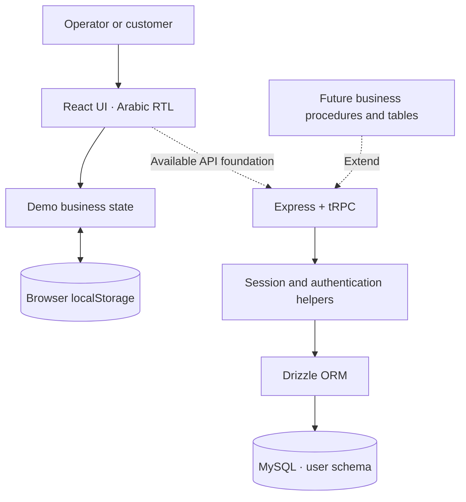

<div align="center">

# 💧 GHASLA | غسلة

### Run every wash. See every opportunity.
### منصة تشغيل ونمو ذكية لمغاسل السيارات

An Arabic-first workspace connecting car-wash operations, customer experience, and business growth.


**🚗 Operations · 💳 Sales · 🎁 Loyalty · 📊 Insights**

</div>

---

## 🌟 Why GHASLA?

Running a car wash means coordinating vehicles, staff, sales, and customers at the same time. GHASLA explores how one clear workspace can connect those tasks and make daily performance visible.

Built around Arabic navigation, right-to-left layouts, and Saudi riyal display, the demo connects a sale to its invoice, service ticket, customer record, and loyalty activity.

> **Current stage:** an interactive prototype using synthetic sample data and browser-local storage. Payments, messaging, and electronic invoicing are simulated. Some management screens are illustrative. The backend foundation is included; car-wash business workflows currently run in the client.

## 🔭 Vision

Make well-run, customer-focused car-wash businesses easier to build and scale across Saudi Arabia.

**رؤيتنا:** تمكين مغاسل السيارات من تشغيل أكثر انتظامًا وتجربة عميل أفضل ونمو قابل للقياس.

## 🎯 Mission

Give operators a simple Arabic workspace that connects the service journey, makes daily performance visible, and helps turn first-time customers into returning customers.

**رسالتنا:** جمع التشغيل والمبيعات والولاء في تجربة عربية واضحة تساعد الفرق على اتخاذ القرار من نفس المكان الذي ترى فيه النتيجة.

## 🧭 Strategy & roadmap

The following is a proposed product direction, with no committed delivery dates.

| Focus | Approach | Progress signal |
| --- | --- | --- |
| 🟢 Validate the experience | Test POS, queue handling, and role-specific navigation with operators | Task completion and fewer manual steps |
| 🔵 Establish reliable records | Move business workflows into typed API procedures and persistent domain tables | Consistent invoices, tickets, and loyalty balances |
| 🟣 Build customer retention | Develop loyalty, subscriptions, referrals, and partner attribution | Repeat visits, redemption, and renewal |
| 🟠 Prepare for scale | Add server-enforced permissions, branch isolation, audit trails, and monitoring | Reliable branch reports and traceable changes |
| 🟡 Connect services | Evaluate payment, messaging, and electronic invoicing integrations | Verified end-to-end integration behavior |

## 🚗 Product experience

| Area | What you can explore |
| --- | --- |
| 📊 Executive overview | Revenue summaries, service activity, branch filtering, and visual reports |
| 💳 Point of sale | Select a customer and service, apply a discount or reward, and create a simulated sale |
| 🫧 Vehicle operations | Move tickets through reception, waiting, washing, inspection, ready, and delivered stages |
| 🧾 Transactions | Browse invoices and explore simulated cancellation behavior |
| 👥 Customers | View customer, vehicle, visit, spending, and loyalty information |
| 🎁 Loyalty | Explore points activity, reward reservation, and redemption |
| 📦 Subscriptions | Explore package and subscription management screens |
| 🤝 Growth | Explore partner codes, referrals, campaigns, and growth insights |
| 🏢 Administration | Explore branches, services, shifts, employees, branding, and settings |
| 📱 Customer experience | Switch to a customer view for balances, rewards, and packages |

**Five demo perspectives:** business owner, branch manager, cashier, operations employee, and customer. The role selector changes the demo experience; production authorization still needs server-side implementation.

### ✨ Try a connected workflow

1. Open the demo and select the cashier perspective.
2. Choose a customer and service in the POS, then complete a simulated sale.
3. Find the resulting invoice and service ticket in their respective screens.
4. Advance the vehicle through the operations queue.
5. Inspect the updated customer and loyalty activity.
6. Use **Settings → Reset demo data** to restore the sample state.

Changes are saved in the current browser through `localStorage`. They are not shared across users or devices. Some reports and administrative panels use illustrative values or preview-only actions.

## 🏗️ Architecture

GHASLA combines an interactive client demo with a full-stack foundation for future persistence and integrations.



**Today:** `Home.tsx` owns the demo state and business interactions. Express hosts the client and exposes tRPC authentication/system procedures. Drizzle currently defines the user table, rather than a complete car-wash domain model.

**Next:** extract domain modules, implement business procedures, and persist customers, branches, invoices, service tickets, subscriptions, and loyalty events with server-side validation.

```text
ghasla/
├── client/
│   ├── public/             # Public browser assets
│   └── src/
│       ├── pages/          # Main demo and route pages
│       ├── components/     # Shared UI components
│       ├── contexts/       # Theme context
│       ├── hooks/          # React hooks
│       └── lib/            # Utilities and tRPC client
├── server/
│   ├── _core/              # Express bootstrap and platform helpers
│   ├── routers.ts          # tRPC router composition
│   └── db.ts               # Database access helpers
├── shared/                 # Shared types and constants
├── drizzle/                # Schema and checked-in migrations
├── patches/                # Dependency patches
└── Dockerfile              # Full-stack container build
```

## 🛠️ Technology stack

Versions reflect the project's declared dependencies.

| Layer | Technologies | Purpose |
| --- | --- | --- |
| Interface | React 19, TypeScript 5.9 | Typed, component-based application |
| Styling | Tailwind CSS 4, custom CSS, Radix UI | Responsive RTL layouts and reusable controls |
| Navigation | Wouter | Client-side routing |
| Visualization | Recharts, Lucide React | Charts and interface icons |
| API client foundation | tRPC 11, TanStack Query 5, SuperJSON | Typed requests, query state, and serialization |
| Server | Node.js, Express 4, tRPC 11, Zod 4 | HTTP hosting, API procedures, and validation |
| Persistence foundation | Drizzle ORM, MySQL, mysql2 | Schema, migrations, and database access |
| Build | Vite 7, esbuild, tsx | Browser builds, server bundling, and development |
| Quality | Vitest 2, TypeScript, Prettier | Tests, type checking, and formatting |
| Packaging | pnpm 10.18, Docker | Dependency and container workflows |

## 🚀 Get started

Use **Node.js 22** (matching the Docker image) and **pnpm 10.18.0**. Start with the browser demo; it needs no database or external service credentials.

```bash
git clone https://github.com/ma1amin/ghasla.git
cd ghasla
pnpm install --frozen-lockfile
pnpm exec vite --host 127.0.0.1 --port 3000
```

Open [http://localhost:3000](http://localhost:3000). The direct Vite command also works on Windows without shell-specific environment syntax.

### ⚙️ Full-stack development

On a POSIX shell, run `pnpm dev`. On Windows PowerShell:

```powershell
$env:NODE_ENV = "development"
pnpm exec tsx watch server/_core/index.ts
```

The server defaults to port `3000` and honors `PORT`. Platform authentication and database features require separately provisioned server-side configuration; the local demo works independently of those integrations.

### 📋 Useful commands

| Command | Purpose |
| --- | --- |
| `pnpm check` | Type-check the project |
| `pnpm test` | Run the existing test suite |
| `pnpm build:static` | Build the browser demo into `dist/public/` |
| `pnpm build` | Build the browser client and Express server |
| `pnpm start` | Start the production server on a POSIX shell |
| `pnpm db:migrate` | Apply checked-in migrations to a configured database |
| `pnpm db:push` | Generate migrations and apply them to a configured database |

For a built server on Windows, set `$env:NODE_ENV = "production"` and run `node dist/index.js`. Database commands require `DATABASE_URL` in the process environment. Review generated migrations before applying them to a shared database.

### 🐳 Container workflow

```bash
docker build -t ghasla .
docker run --rm -p 3000:3000 ghasla
```

Provision integration credentials through the deployment environment when those features are needed.

## 🔐 Privacy & configuration

- Use synthetic data when sharing this demo or screenshots.
- Keep credentials, private keys, connection strings, and real customer records outside Git.
- Supply private configuration through the server environment or a secret manager.
- `server/_core/publicConfig.ts` explicitly selects browser-visible runtime values; review additions carefully.
- Browser-local storage and the demo role selector are prototype mechanisms. Real customer workflows need authenticated APIs, server-enforced access control, and persistent records.

## 💡 Suggested improvements

- **Visual walkthrough:** add sanitized screenshots and a short recording of the POS-to-service journey.
- **Domain structure:** split the main demo page into feature modules with reusable business logic.
- **Workflow tests:** cover sales, cancellations, queue transitions, and reward reservation/redemption.
- **Continuous integration:** run type checks, tests, and builds for each proposed change.
- **Production foundation:** implement branch permissions, audit history, backup/recovery, and integration monitoring.
- **Project governance:** add a license file once licensing is confirmed, plus contribution and security-reporting guidance.

## 🤝 Contributing

Open an issue describing the problem or proposal, then submit a focused pull request with relevant validation. Keep examples and screenshots free of real customer data and credentials.

The package metadata declares MIT; this snapshot does not include a standalone license file. Confirm and add the intended license before relying on redistribution terms.

---

<div align="center">

**💧 GHASLA — clearer operations, better customer journeys.**

غسلة — تشغيل أوضح، وتجربة عميل أفضل.

</div>
